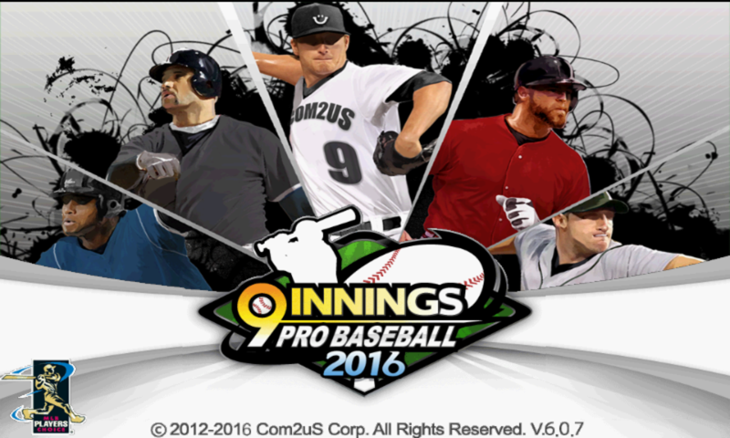
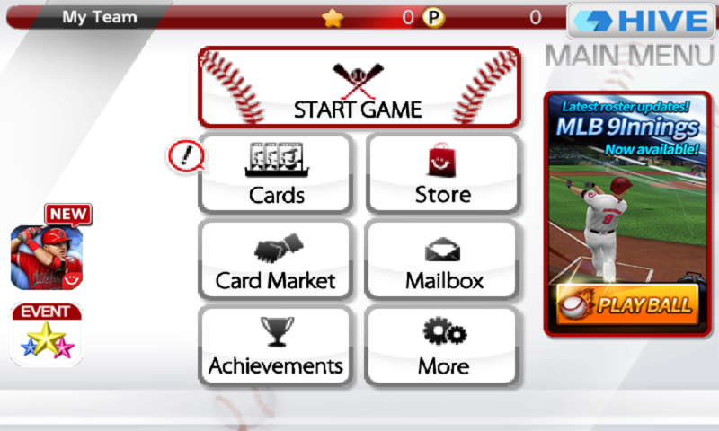
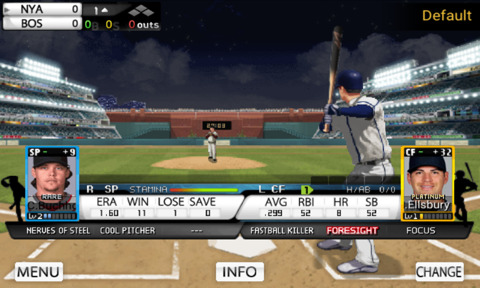
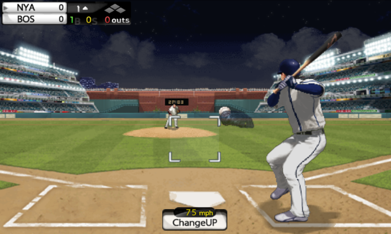
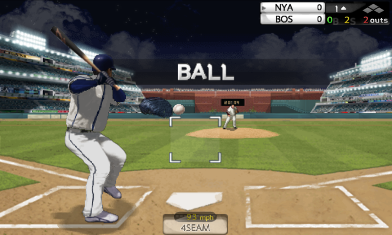
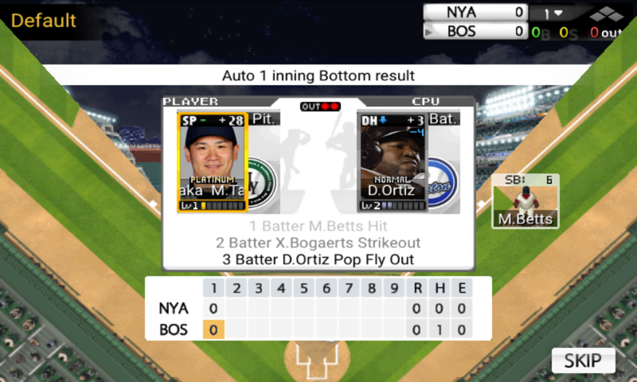
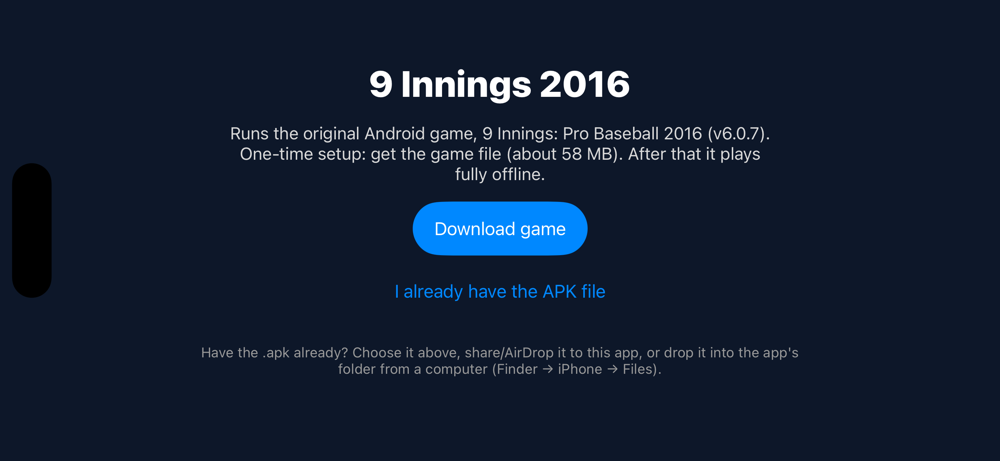

# 9 Innings 2016 for iPhone

**The original *9 Innings: Pro Baseball 2016* (Com2uS, Android v6.0.7), running on iPhone.**
It isn't a remake: the app runs the game's own engine in an ARM interpreter, so menus, stadiums, pitching and batting look and play exactly like 2016.

| | |
|---|---|
|  |  |
|  |  |
|  |  |

*Real screenshots from this app (iOS simulator), not promotional art.*

> **No game files are in this repo or in the app download.** On first launch the app downloads the original APK from a public mirror by itself and checks the file's SHA-256 against `supported-apks.json`. From then on it plays offline.
>
> 

## Install

Pick the first row that fits you.

| You have… | Do this | Time |
|---|---|---|
| **A Mac** (or Claude/Codex running on one) | [Mac: one command](#mac-one-command) | ~10 min |
| **Windows / Linux / a Mac without Xcode** | [Sideload the IPA](#sideload-the-ipa) with Impactor or Sideloadly | ~5 min |
| **SideStore or AltStore** already on the iPhone | [Add the source](#sidestore--altstore) | 1 min |

Every option uses a free Apple ID, and Apple signs free-ID apps for **7 days** at a time. How to keep it working:

- **SideStore (recommended, set-and-forget):** it re-signs the app in the background on the phone, without a computer, so in practice it never expires. Open SideStore now and then, or use a Shortcuts automation, so the refresh runs.
- **Mac / Impactor / Sideloadly:** reinstall once a week. Your save is kept.
- **Paid Apple developer account ($99/yr):** signatures last a year.

TrollStore installs never expire, but TrollStore only works on old iOS versions (up to 17.0), not on current iPhones.

### Mac: one command

```sh
git clone https://github.com/benverhaalen/nine-innings-ios26 && cd nine-innings-ios26
python3 scripts/build.py doctor     # checks Xcode, Rust, your Apple ID and the iPhone, and tells you what to fix
python3 scripts/build.py device     # builds, signs with your Apple ID and installs on the connected iPhone
```

The app gets the game's original icon, downloaded while it builds. `--icon icon.png` uses any square PNG instead.

First time only: install Xcode (App Store) and Rust (`curl https://sh.rustup.rs -sSf | sh`, then `rustup target add aarch64-apple-ios aarch64-apple-ios-sim`). Sign in to Xcode with your Apple ID (Settings → Accounts). Connect the iPhone by cable, unlock it and tap *Trust*.

On the iPhone, trust your Apple ID (Settings → General → VPN & Device Management) and enable Developer Mode if asked. Then open **9 Innings** and tap **Download game**.

> **Using an AI agent?** Tell it: *"Install the game from this repo on my iPhone."* [AGENTS.md](AGENTS.md) has the exact steps.

### Sideload the IPA

1. Download **`NineInnings26.ipa`** from [Releases](https://github.com/benverhaalen/nine-innings-ios26/releases/latest).
2. Install it with one of these, signing in with a free Apple ID:
   - [Impactor](https://github.com/khcrysalis/PlumeImpactor) **2.7.2 or newer** (Windows/macOS/Linux)
   - [Sideloadly](https://sideloadly.io) (Windows/macOS)
3. Trust the profile and enable Developer Mode as above, then open the app and tap **Download game**.

### SideStore / AltStore

Add this source: `https://github.com/benverhaalen/nine-innings-ios26/releases/latest/download/apps.json`, then install **9 Innings 2016**. Updates appear automatically.
Don't have SideStore yet? [iloader](https://github.com/nab138/iloader) (2.4.0 or newer) sets it up from a computer in a few clicks.

## First launch

- **Download game** fetches the APK from APKMirror by itself (about 58 MB, once) and installs the game. You don't see or tap anything on the website; ads and trackers are blocked.
- **I already have the APK file** lets you pick a `.apk` from Files. You can also AirDrop or share it to the app, or copy it into the app's folder with Finder (iPhone → Files → 9 Innings).
- Only the exact file is accepted: v6.0.7, SHA-256 `50b1cd98…df9221`.

## What works

- Offline play: setup, team selection, main menu, game modes and Friendly-match gameplay are verified (screenshots above). League, Special and Home Run modes use the same engine and are expected to work, but haven't been checked one by one yet. Saves persist on the device.
- Online features run against replacement servers, because Com2uS shut the real ones down:
  - A server built into the app (`runtime/src/game_server.rs`) handles your own account: HIVE login (automatic, local account), daily login bonus, Mailbox and Tradebox, the Store with Stars and Points you earn, and star items.
  - A shared server ([server/](server/), a free Cloudflare Worker) handles what involves other players: NetPoints, the Card Market, gifts and Online Ranking. Everyone who installs this app trades on the same market.
  - Checked in the app, against a local copy of the shared server:
    - registering a card for sale
    - searching by team, league, rating, level, position, price order, player name and seller ID
    - buying a card
    - collecting sale proceeds from the Trading Box
    - exchanging Points for NetPoints
    - receiving a gift
  - Without internet, the shared features say so and everything else keeps working.
- The shop is **earn-only**: real-money packs answer "Purchases are disabled. Earn Stars and Points by playing."
- Performance: the engine runs at its native 20 updates per second (its own 50 ms timer).
- Not implemented yet: sound.

## Limitations

This is a revival, not the original service. Read this before expecting the 2016 experience:

- **The shared server isn't live yet.** Its code is here and tested against a local copy, but it hasn't been deployed. Until then the Card Market, NetPoints, gifts and rankings say they're unavailable; everything else works.
- **A small, volunteer-run shared server.** The Card Market, gifts and rankings run on one free Cloudflare Worker ([server/](server/)). It has a daily free quota of about 100,000 requests. If that is used up, online features say they're unavailable until the next day (UTC); it never costs anyone money. It has no uptime guarantee, and if it's ever shut down, those features stop working. Anyone can deploy their own copy.
- **Cheating can't be fully prevented.** As in the original game, your Stars, Points, cards and stats live on your phone. The server can't check them, so a modified app could list cards or report stats it never earned. The server limits how much of that can reach other players:
  - NetPoints are held only on the server.
  - Point deposits are capped at 30,000 a day, and gifts at 10 and 30,000 Points a day.
  - Each player can have at most 20 listings.
  - Each purchase, exchange and gift is applied exactly once.
  - Ranking progress can only grow at a believable hourly rate.
  - New IDs and requests are rate-limited.

  What it can't do is prove that a card on the market was earned honestly.
- **Market differences.**
  - The cheerleader search filter is ignored, so cheerleader searches show all cheerleaders.
  - Unsold cards return after 10 days.
  - Legend cards can't be sold or given, as in the original.
  - Player-name search matches the names in your own copy of the game's player tables, so a listing made by a modified app may have no name and only show up in unfiltered searches.
- **Rankings start fresh.** Only progress made after you first connect counts, it's counted at a limited rate per hour, and you won't appear on the boards during your first hour. Boards refresh every 30 minutes.
- **Your market identity is tied to this install.** The shared server knows you by a random secret stored with your save. If you delete the app, you lose your NetPoints and your listings. Player names are assigned (e.g. `PLAYER12345`).
- **No real-money purchases.** Star and point packs are declined. Earn Stars and Points by playing.
- **Guessed economy.** The original star-item prices and daily-bonus rewards aren't documented anywhere we could find, so they're reasonable stand-ins. Store tiles can show a different star price from the confirmation dialog; the dialog's price is what you pay.
- **Fake HIVE account.** The account is created on the device. There's no cloud save and no cross-device login; your save lives only on this iPhone. Deleting the app deletes it.
- **Old accounts are gone.** Progress saved on Com2uS's servers before the shutdown can't be recovered.
- **Gone for good:** events and promotions, news, push notifications, Com2uS links and cross-promotion. The game may still show their buttons; they do nothing useful.
- **Not every online screen has been exercised.** The replies were rebuilt from the game's own code; the screens listed above were checked in the app, others (e.g. some event and exchange paths) only by analysis. Unsupported calls show up as `STOP …` in `Documents/engine.log`; please [open an issue](../../issues) with it.
- **Emulated.** The original Android code runs in an ARM interpreter: about 20 fps (the game's native rate), more battery use than a native app, no sound yet.
- **Sideloading.** It's not on the App Store. A free Apple ID signature lasts 7 days, and the first launch needs the APK from a public mirror (or your own copy).

## Troubleshooting

| Message / symptom | Fix |
|---|---|
| "Unable to Verify App" / the app won't open | Settings → General → VPN & Device Management → trust your Apple ID. Developer Mode must be on (Settings → Privacy & Security). |
| The app stopped opening after a week | The free 7-day signature expired. Run `build.py device` again, or refresh in SideStore/AltStore. Your save stays. |
| Sideloading tool rejects your Apple ID login (since Oct 2026) | Update to Impactor 2.7.2+ / iloader 2.4.0+, or use the Mac route, which signs through Xcode. |
| "This isn't the supported APK" | The file isn't v6.0.7 (`com.com2us.nipb2013…`, 60,322,552 bytes). Use **Download game**, or get that exact file. |
| The mirror's page appears after "Getting the game…" | The automatic download didn't start within 45 s (the site may have changed). Tap the APK download button on the page. If the mirror is gone, use **I already have the APK file** and [open an issue](../../issues). |
| `build.py doctor` shows FIX lines | Do what each line says, then rerun. |

## For developers

```
runtime/ios-graphics.m       UIKit host: rendering, touch, text, first-launch download/import
runtime/src/bin/engine-startup.rs   loads libgame.so from the APK and runs it; fake JNI/Android
runtime/src/game_server.rs   replacement game server (local, earn-only), saved server state, client for the shared server
server/                      shared online service (Cloudflare Worker + D1): market, NetPoints, gifts, rankings
runtime/src/apk.rs           reads assets, JNI method list and string resources from the APK at launch
runtime/src/dalvik.rs        tiny Dalvik interpreter for the game's two Java text-layout methods
vendor/touchhle-arm-interpreter   ARMv7 interpreter (from touchHLE, MPL-2.0)
scripts/build.py             doctor / ipa / device / simulator
```

`python3 scripts/build.py simulator` runs it in the iOS Simulator. [AGENTS.md](AGENTS.md) covers the test hooks for scripted taps and screenshots.

## Legal

*9 Innings* and all of its content belong to Com2uS. This repository contains none of it; the release IPA includes only the game's icon, downloaded from a public image host when it's built. It is an independent compatibility layer that runs a copy of the game you download yourself. It is not affiliated with or endorsed by Com2uS, MLB or the MLBPA. Code: MIT ([LICENSE](LICENSE)); third-party components: [THIRD_PARTY_NOTICES.md](THIRD_PARTY_NOTICES.md).
